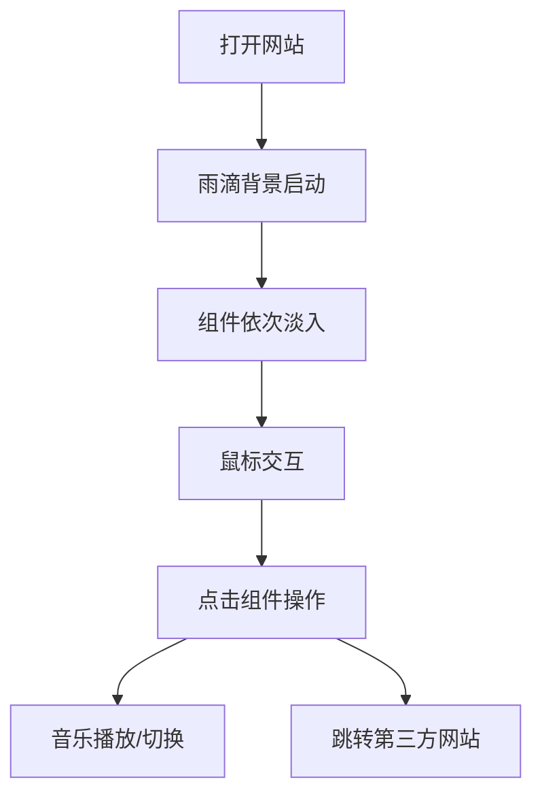

## 1. 产品概述
个人门户网站——车机中控大屏风格的中央控制平台，以独特的雨滴交互效果展现个人特色，集成音乐、时间、天气、每日一言等日常信息，打造极具科技感与沉浸感的个人数字空间。

## 2. 核心特性

### 2.1 功能模块
1. **首页仪表盘**: 中央控制平台主界面，所有组件的容器
2. **雨滴效果背景**: 全屏动态雨滴效果，支持鼠标与界面元素交互
3. **音乐播放器**: 展示当前播放音乐、播放控制
4. **每日一言**: 每日励志/哲理句子展示
5. **日期时间**: 实时显示北京时间（年月日、时分秒、星期）
6. **第三方网址链接**: 个人其他网站快捷入口
7. **当前天气**: 实时天气信息展示

### 2.2 页面详情
| 页面名称 | 模块名称 | 功能描述 |
|-----------|-------------|---------------------|
| 首页仪表盘 | 雨滴背景层 | 全屏雨滴动画，鼠标划过产生涟漪，界面元素阻挡雨滴产生溅射效果 |
| 首页仪表盘 | 中央控制区 | 车机风格的卡片式布局，承载各功能组件 |
| 首页仪表盘 | 音乐播放器 | 歌曲信息、播放/暂停、上一首/下一首、进度条 |
| 首页仪表盘 | 每日一言 | 每日更新的名言警句，作者信息 |
| 首页仪表盘 | 日期时间 | 实时时钟、日期、星期，北京时间 |
| 首页仪表盘 | 网址链接 | 图标化的第三方网站快捷入口 |
| 首页仪表盘 | 天气卡片 | 当前温度、天气状况、城市 |

## 3. 核心流程
用户打开网站 → 雨滴背景动画启动 → 各组件按序淡入呈现 → 用户鼠标移动与雨滴交互 → 用户点击各组件进行操作

## 4. 用户界面设计

### 4.1 设计风格
- **主色调**: 深邃的午夜蓝/黑色背景，搭配青色/冰蓝色高光点缀，营造雨夜车机的沉浸感
- **辅助色**: 柔和的白色/浅灰色文字，半透明玻璃拟态卡片
- **按钮风格**: 圆角矩形，半透明背景，发光边框，hover 时有脉冲光效
- **字体**: 现代无衬线字体，数字使用等宽字体增强科技感
- **布局风格**: 车机中控大屏风格——中央大区域为主显示，四周环绕功能卡片，非对称布局，有纵深层次感
- **图标风格**: 线性图标，发光效果，与整体科技感统一

### 4.2 页面设计概述
| 页面名称 | 模块名称 | UI 元素 |
|-----------|-------------|-------------|
| 首页仪表盘 | 雨滴背景 | 深蓝色渐变背景，雨滴下落动画，涟漪效果，溅射粒子 |
| 首页仪表盘 | 玻璃拟态卡片 | 半透明白色/蓝色背景，模糊效果，细边框，圆角，阴影 |
| 首页仪表盘 | 时间显示 | 大号等宽字体数字，居中或左上位置，日期星期辅助 |
| 首页仪表盘 | 音乐播放器 | 底部或右侧，专辑封面占位，进度条，控制按钮 |
| 首页仪表盘 | 每日一言 | 斜体文字，引用符号装饰，作者署名 |
| 首页仪表盘 | 天气卡片 | 天气图标，温度数字，城市名 |
| 首页仪表盘 | 网址链接 | 图标网格，hover 放大发光 |

### 4.3 响应式
- 桌面端优先，适配 1920x1080 及以上大屏
- 中等屏幕自适应缩放
- 组件布局可根据屏幕尺寸调整排列
