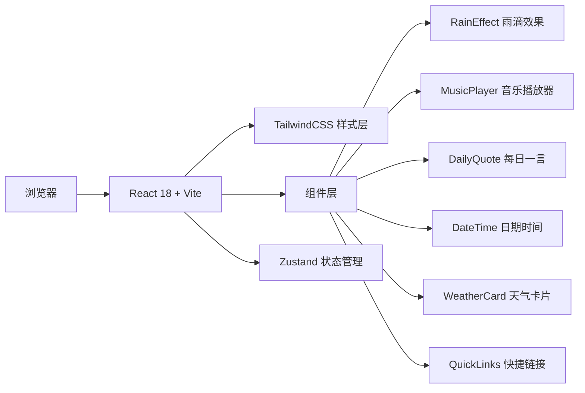

## 1. 架构设计



## 2. 技术描述

* **前端框架**: React 18 + TypeScript

* **构建工具**: Vite 5

* **样式方案**: TailwindCSS 3

* **状态管理**: Zustand

* **路由**: react-router-dom（单页应用，预留扩展）

* **图标库**: lucide-react

* **动画**: CSS animations + requestAnimationFrame + Canvas 2D（雨滴效果）

* **后端：无后端**

* **数据**: 通过调用xxAPI.com网址里的免费API

## 3. 路由定义

| 路由 | 用途              |
| -- | --------------- |
| /  | 首页仪表盘（所有组件的主界面） |

## 4. 项目结构

```
src/
├── components/
│   ├── layout/
│   │   └── DashboardLayout.tsx    # 仪表盘布局容器
│   ├── rain/
│   │   └── RainEffect.tsx         # 雨滴效果组件
│   ├── music/
│   │   └── MusicPlayer.tsx        # 音乐播放器
│   ├── quote/
│   │   └── DailyQuote.tsx         # 每日一言
│   ├── datetime/
│   │   └── DateTimeDisplay.tsx    # 日期时间显示
│   ├── weather/
│   │   └── WeatherCard.tsx        # 天气卡片
│   └── links/
│       └── QuickLinks.tsx         # 快捷链接
├── hooks/
│   └── useRainEffect.ts           # 雨滴效果逻辑 hook
├── store/
│   └── useDashboardStore.ts       # 仪表盘状态管理
├── utils/
│   └── time.ts                    # 时间工具函数
├── data/
│   ├── quotes.ts                  # 名言数据
│   └── links.ts                   # 链接数据
├── pages/
│   └── Dashboard.tsx              # 仪表盘首页
├── App.tsx
├── main.tsx
└── index.css
```

## 5. 组件数据结构

### 5.1 音乐播放器

```typescript
interface Track {
  id: string;
  title: string;
  artist: string;
  album: string;
  coverUrl: string;
  duration: number;
}
```

### 5.2 每日一言

```typescript
interface Quote {
  text: string;
  author: string;
}
```

### 5.3 天气数据

```typescript
interface WeatherData {
  city: string;
  temperature: number;
  condition: string;
  icon: string;
  humidity: number;
}
```

### 5.4 快捷链接

```typescript
interface QuickLink {
  id: string;
  name: string;
  url: string;
  icon: string;
}
```

